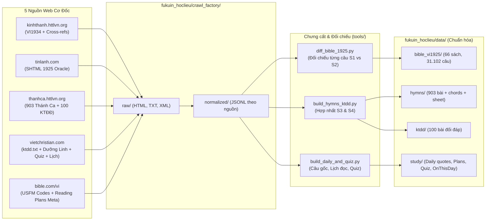

# Danh Mục Nguồn Dữ Liệu (`fukuin_hoclieu/crawl_factory/sources/docs/`)

> **Nguyên tắc Nguồn & Bản quyền (Provenance & Copyright Gate):**
> Kho `crawl_factory` chỉ đóng vai trò thu thập, đối chiếu chéo và phân tích cấu trúc nội bộ. Không sao chép nguyên trạng giao diện hoặc các tài sản có bản quyền thương mại lên site công khai `fukuin`. Mọi dữ liệu đưa sang tầng xuất bản (`fukuin_hoclieu/data/` $\rightarrow$ `fukuin`) phải đi qua hợp đồng lọc và chuẩn hóa tại [distill-contract.md](./distill-contract.md), ưu tiên tuyệt đối văn bản thuộc **Phạm vi công cộng (Public Domain)** như Kinh Thánh Bản Truyền Thống 1925 (`VI1934`), Kinh Thánh Đối Đáp truyền thống và các bài Thánh Ca cổ điển.

---

## 1. Bảng Tổng Hợp Các Nguồn Khảo Sát

Đã khảo sát kỹ thuật trực tiếp ngày **08/11/2026**. Toàn bộ 5 nguồn đều phản hồi HTTP `200 OK` ổn định, không có tường lửa CAPTCHA chặn truy cập đọc thông thường.

| Source ID | Tên miền gốc | Vai trò trong hệ sinh thái `fukuin` | Giữ lại cho học liệu (`data/`) | Không giữ làm bài đăng công khai | Tài liệu chi tiết |
|-----------|--------------|-------------------------------------|--------------------------------|----------------------------------|-------------------|
| **`kinhthanh_httlvn`** | [kinhthanh.httlvn.org](https://kinhthanh.httlvn.org) | Nguồn chính (Primary) cho văn bản Kinh Thánh `VI1934` (1925), tiêu đề phân đoạn, tham chiếu chéo (`⚓`) | 66 sách, 1.189 chương, ~31.102 câu bản `VI1934`; tiêu đề mục; đồ thị câu đối chiếu (`⚓`) | Toàn văn các bản dịch mới có bản quyền (`RVV11`, `BD2011`, `NVB`, `BPT`, `BDY`); byte MP3 (chỉ lưu metadata/link) | [kinhthanh-httlvn.md](./kinhthanh-httlvn.md) |
| **`thanhca_httlvn`** | [thanhca.httlvn.org](https://thanhca.httlvn.org) | Nguồn chính (Primary) cho 903 bài Thánh Ca & 100 bài Kinh Thánh Đối Đáp | Lời ca, hợp âm (`[G]`, `[Am]`), thông tin tác giả/năm, phân loại 18 chủ đề, MusicXML (sheet), 100 bài KTĐĐ + chỉ mục câu gốc | File MP3/PPTX nặng không nhúng vào Git repo tĩnh; bài hát đương đại hạn chế bản quyền nếu có yêu cầu gỡ | [thanhca-httlvn.md](./thanhca-httlvn.md) |
| **`vietchristian`** | [vietchristian.com](https://vietchristian.com) | Nguồn làm giàu (Enrichment): Câu gốc theo tâm trạng (Dưỡng Linh), Lịch đọc 4 lộ trình, Thánh Kinh Lược Khảo, Đố Kinh Thánh, Lịch lễ tiết | Chỉ mục câu gốc Dưỡng Linh, cấu trúc 4 lịch đọc năm, câu hỏi trắc nghiệm tham khảo, file `/thanhca/ktdd.txt` để đối chiếu KTĐĐ | Tin tức thời sự, bài giảng cá nhân, danh bạ hội thánh hải ngoại (`niengiam`), dữ liệu đăng nhập | [vietchristian.md](./vietchristian.md) |
| **`bible_com`** | [bible.com/vi](https://www.bible.com/vi) | Nguồn tham chiếu chuẩn hóa mã sách USFM, thông tin bản quyền 7 bản dịch Việt, mẫu Verse of the Day & Reading Plans | Bảng ánh xạ mã sách chuẩn quốc tế (USFM: `GEN`..`REV`), thông tin pháp lý từng bản dịch, danh mục chủ đề Reading Plans | Toàn văn các bản dịch có bản quyền (`VIE2010`, `BD2011`, `NVB`, `BPT`, `KTHD`, `FHB-VI`), bài suy ngẫm có bản quyền | [bible-com.md](./bible-com.md) |
| **`tinlanh_com`** | [www.tinlanh.com](https://www.tinlanh.com) & `GetBible v2` | Hội đồng đối chiếu 3 nguồn (3-Way Majority Voting Oracle) cho văn bản Kinh Thánh 1925 & khung bài học | Văn bản thuần (`.shtml` + `getbible/vietnamese.json`) của 66 sách Cựu/Tân Ước để diff chính tả từng câu với `kinhthanh.httlvn.org` | Các bài viết chuyên đề Khoa học & Niềm tin, tài liệu PDF riêng của tác giả | [tinlanh-com.md](./tinlanh-com.md) |
| **`open_bibles_multilang`** | OpenScriptures / eBible.org / Bolls.life / GetBible / Wikipedia JA | Kho văn bản gốc & đa ngôn ngữ 100% Public Domain để tham chiếu chéo và học ngoại ngữ | Nguyên bản Hê-bơ-rơ (`ORIG_WLC`) + Hy Lạp (`ORIG_GNT`) kèm số Strong (`H1..H8674`, `G1..G5624`); Tiếng Anh `EN_WEB` + `EN_KJV`; Tiếng Nhật `JA_KOUGO` (`JPKJV.json` có Ruby) + `JA_BUNGO`; Thánh Ca Nhật `SANBIKA_1954` | Các bản dịch tiếng Nhật/Anh hiện đại có bản quyền (*Shin Kyoudou Yaku*, *Shinkaiyaku*, *NIV*, *ESV*, *Sanbika 21*) | [multilingual-open-bibles-hymns.md](./multilingual-open-bibles-hymns.md) |

---

## 2. Sơ Đồ Luồng Dữ Liệu Từ Crawl Factory Sang Học Liệu

---

## 3. Quy Chuẩn Vận Hành Crawler (`crawl_factory`)

1. **Tôn trọng máy chủ nguồn (Polite Crawling)**:
   - Tất cả các nguồn (`httlvn.org`, `vietchristian.com`, `tinlanh.com`) là máy chủ phục vụ cộng đồng phi lợi nhuận.
   - **Bắt buộc**: Đặt độ trễ `delay = 1.0s – 2.5s` giữa các request, chạy tuần tự (concurrency = 1 cho mỗi domain), lưu cache HTML thô vào đĩa và hỗ trợ `--resume` để không bao giờ tải lại trang đã có.
2. **Bảo toàn mã hóa tiếng Việt (UTF-8 & Tiền chiến)**:
   - Văn bản Kinh Thánh 1925 sử dụng nhiều từ vựng và chính tả cổ đặc trưng (*nhứt, sanh, dựng nên, khoảng không, Ê-díp-tô, Giê-ru-sa-lem*).
   - Khi parse HTML, bắt buộc giải mã HTML entities (`&#225;`, `&emsp;`, `&nbsp;`) về UTF-8 chuẩn NFC nhưng **tuyệt đối không tự ý sửa từ cổ sang từ hiện đại** (ví dụ: giữ nguyên *“ngày thứ nhứt”*, không đổi thành *“ngày thứ nhất”* nếu bản gốc `VI1934` viết *“nhứt”*), trừ việc chuẩn hóa ký tự `Ð` (Latin Capital Letter Eth `U+00D0` hay gặp trên `vietchristian.com`) về đúng chữ `Đ` (`U+0110`) tiếng Việt.
3. **Danh mục tài liệu trong thư mục này**:
   - [technical-design-and-anti-blocking.md](./technical-design-and-anti-blocking.md) — Thiết kế lõi `CrawlerCore`, quản lý trạng thái nguyên tử (`state/`), cấu hình `config.json`, chống chặn & **Bảng Kiểm Tra 18 Bẫy Runtime (`TRAP A1` – `TRAP E1`)**.
   - [kinhthanh-httlvn.md](./kinhthanh-httlvn.md) — Đặc tả nguồn Kinh Thánh HTTLVN (bảng 66 mã sách, 6 bẫy mã URL, cú pháp `][gt=`, thượng đề `<i>`, ngắt dòng thơ).
   - [thanhca-httlvn.md](./thanhca-httlvn.md) — Đặc tả nguồn Thánh Ca & Kinh Thánh Đối Đáp HTTLVN (chiến lược giảm 78% request, 7 container DOM khác nhau, 2 họ DOM lời hát, bẫy hợp âm giữa từ ghép).
   - [vietchristian.md](./vietchristian.md) — Đặc tả nguồn VietChristian (7 request tĩnh, khôi phục Double-UTF8 `tklk.xml`, sửa lỗi `Ð` `U+00D0`, lấy bảng ánh xạ tên bài tiếng Anh qua 2 lệnh POST).
   - [bible-com.md](./bible-com.md) — Đặc tả nguồn YouVersion Bible.com & ranh giới bản quyền các bản dịch mới.
   - [tinlanh-com.md](./tinlanh-com.md) — Đặc tả nguồn TinLanh.com & `GetBible vietnamese.json` (thuật toán Biểu quyết Đa số 2/3 trên 31.102 câu).
   - [multilingual-open-bibles-hymns.md](./multilingual-open-bibles-hymns.md) — Đặc tả nguồn mở đa ngôn ngữ: Nguyên bản Hê-bơ-rơ (`WLC`)/Hy Lạp (`GNT` + Strong's), Tiếng Anh (`WEB`, `KJV`), Tiếng Nhật (`口語訳 1955` có Ruby + bẫy lệch số câu `[0]`/`[00]`, `文語訳 1917`) & Thánh Ca Nhật (`讃美歌 1954`).
   - [distill-contract.md](./distill-contract.md) — Hợp đồng chưng cất dữ liệu từ `crawl_factory` sang `fukuin_hoclieu/data` và `fukuin`.

