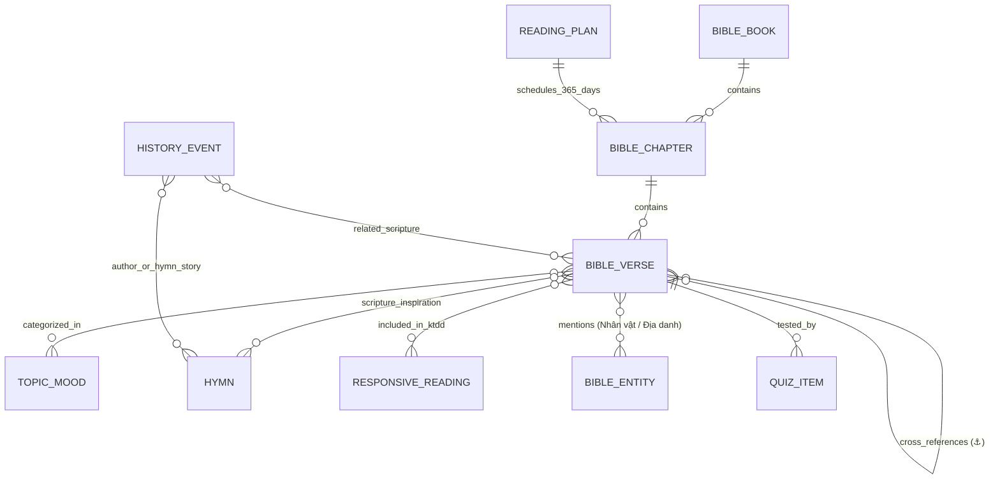
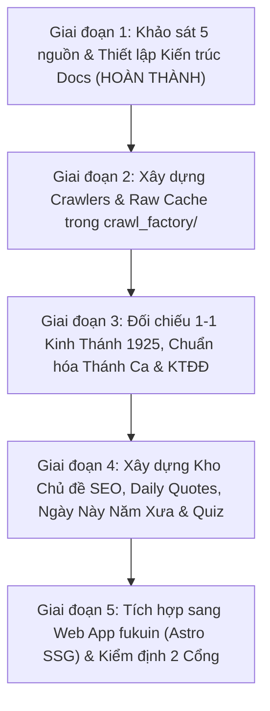

# Single Source of Truth (SoT): Kiến Trúc Dữ Liệu & Lộ Trình Học Liệu `fukuin_hoclieu`

> **Tài liệu chuẩn hóa chính thức (Single Source of Truth - SoT)** dành cho dự án **Fukuin Học Liệu Số (`fukuin_hoclieu`)** — nền tảng dữ liệu cho website Kinh Thánh, Thánh Ca & Học Liệu Cơ Đốc Tiếng Việt miễn phí **[fukuin](../../fukuin/docs/README.md)**.
>
> * **Phiên bản**: `1.0-INITIAL`
> * **Ngày khởi tạo**: 08/11/2026
> * **Kho dữ liệu**: [c:\HomeWorking\911\repos\fukuin_hoclieu](file:///c:/HomeWorking/911/repos/fukuin_hoclieu)
> * **Kho ứng dụng Web**: [c:\HomeWorking\911\repos\fukuin](file:///c:/HomeWorking/911/repos/fukuin)

---

## 1. Tầm Nhìn Dự Án & 4 Trụ Cột Cốt Lõi

Dự án **Fukuin** (`福音` — *Phúc Âm / Tin Lành*) hướng tới xây dựng một **Thư viện Tĩnh & Học Liệu Tương Tác Cơ Đốc Tiếng Việt** hoàn toàn miễn phí, tốc độ tải tức thì (< 0.3s), chuẩn SEO, không quảng cáo và hoạt động bền vững không cần máy chủ backend đắt đỏ.

### 6 Trụ Cột Nội Dung & Lợi Thế Độc Bản:
1. **Kinh Thánh Đối Chiếu 6 Bản Đa Ngữ & Nguyên Bản Gốc (100% Public Domain)**:
   - Thay vì phụ thuộc vào các bản dịch hiệu đính mới có bản quyền, `fukuin` tạo ra sức mạnh vượt trội bằng cơ chế **tham chiếu chéo 6 văn bản mở** trên từng câu:
     1. **Tiếng Việt**: Bản Truyền Thống 1925 (`VI1934`) — đối chiếu từng câu giữa `kinhthanh.httlvn.org` và `tinlanh.com`.
     2. **Tiếng Anh Hiện Đại**: **World English Bible (`EN_WEB`)** — giúp hiểu rõ nghĩa hiện đại của câu Kinh Thánh tức thì.
     3. **Tiếng Anh Cổ Điển**: **King James Version 1769 (`EN_KJV`)** — gắn sẵn mã số Strong (`Strong's Numbers`) cho từng từ.
     4. **Tiếng Nhật Hiện Đại**: **口語訳聖書 1954/1955 (`JA_KOUGO`)** — văn phong hiện đại, chữ Kanji thông dụng kèm Furigana & Hán-Việt.
     5. **Tiếng Nhật Cổ Văn**: **文語訳聖書 1917 (`JA_BUNGO`)** — kiệt tác văn học cổ điển Nhật Bản, giàu từ vựng Hán-Nhật tương đồng với từ Hán-Việt của bản 1925.
     6. **Nguyên Bản Hê-bơ-rơ & Hy Lạp**: **Westminster Leningrad Codex (`ORIG_WLC` Cựu Ước)** & **Greek New Testament (`ORIG_GNT` Tân Ước)** kèm từ điển gốc Strong (`H1..H8674`, `G1..G5624`).
2. **Không Gian Thánh Ca Đa Ngữ Việt – Anh – Nhật (903 Bài Thánh Ca + 讃美歌 Sanbika 1954)**:
   - Cung cấp lời ca chuẩn, hợp âm trực quan (Transpose đổi tông tức thì), bản nhạc vector (`MusicXML`), đồng thời **đối chiếu lời tiếng Anh gốc và lời Thánh Ca tiếng Nhật (`讃美歌 1954` — *Sanbika 1954*)** cho các bài Thánh Ca kinh điển thế giới.
3. **Tuyển Tập Câu Chuyện Kinh Thánh Với Minh Họa Bút Chì (Pencil Sketch Illustrations)**:
   - 60 câu chuyện Kinh Thánh xuyên suốt Cựu Ước & Tân Ước được biên soạn súc tích đa ngôn ngữ, minh họa bằng **tranh vẽ bút chì than cổ điển trên nền giấy da ấm** (xem chi tiết tại [cau-chuyen-kinh-thanh-va-minh-hoa-but-chi.md](./cau-chuyen-kinh-thanh-va-minh-hoa-but-chi.md)).
4. **Tách Các Đoạn Kinh Thánh Nổi Tiếng & Hệ Sinh Thái Trích Dẫn Chuẩn SEO**:
   - Tách riêng các **Đoạn Kinh Thánh Nổi Tiếng** (*Mười Điều Răn*, *Thi-thiên 23*, *Các Phước Lành trên Núi*, *Bài Cầu Nguyện Chung*, *Chương Tình Yêu Thương 1 Cô-rinh-tô 13*...), câu gốc theo tâm trạng, **Daily Quotes (366 ngày)** và **Ngày Này Năm Xưa** thành các trang đích giàu ngữ nghĩa có sức mạnh SEO cực cao.
5. **Trợ Năng Đặc Biệt Cho Người Cao Tuổi (`ops_sources/kannert`)**:
   - Tích hợp sâu bộ công cụ trợ năng `my-liking-widget` (`kannert`) với chế độ 1-chạm dành cho tín hữu lớn tuổi: phóng chữ 200%–300%, thước dẫn dòng chống nhảy dòng (`readingGuide`), hộp sáng tập trung (`narrowYourFocus`), độ tương phản cao và đọc văn bản bằng giọng nói.
6. **Học & Tra Cứu Chéo Ngôn Ngữ (Kế Thừa `hoctamquoc` & `LumiLearnWeb`)**:
   - Tích hợp tách từ tiếng Nhật, hiển thị Furigana / Romaji / Âm Hán-Việt, giải nghĩa từ gốc Hê-bơ-rơ/Hy Lạp, liên kết 1-chạm sang từ điển `LumiLearnWeb` (`JpLink` / `EnLink`) và hộp học Flashcard/Quiz lưu tiến độ `localStorage`.

---

## 2. Sơ Đồ Đồ Thị Liên Kết Đa Chiều (Bidirectional Knowledge Graph)

Giống như cách `RoTK9_hoclieu` liên kết hai chiều giữa *Văn bản $\leftrightarrow$ Tướng $\leftrightarrow$ Địa danh $\leftrightarrow$ Từ vựng*, `fukuin_hoclieu` không lưu các mục rời rạc mà kết nối chúng thành một **Đồ thị Tri thức Kinh Thánh & Thánh Ca**:

### Giá trị thực tiễn của Đồ thị 2 chiều trên trang tĩnh:
* Khi người đọc đang xem **Thi-thiên 23:1** (`/kinh-thanh/thi-thien/23#1`), trang hiển thị ngay:
  * Các câu **Tham chiếu chéo** (`Giăng 10:11`, `Ê-sai 40:11`, `Hê-bơ-rơ 13:20`).
  * Bài **Kinh Thánh Đối Đáp** có chứa đoạn này (*Bài 15 – Đấng Chăn Chiên Hiền Lành*).
  * Các bài **Thánh Ca** lấy cảm hứng từ đoạn này (*Thánh Ca 284 – Chúa Chăn Giữ Tôi*).
  * Các **Chủ đề Dưỡng Linh** chứa câu này (*Khi cô đơn hay sợ hãi*, *Sự bình an*).
  * Nút **"Thuộc câu gốc này"** mở ngay hộp bài tập điền từ khuyết / sắp xếp chữ.

---

## 3. Tổng Quan Quy Mô Kho Dữ Liệu Mục Tiêu (`data/`)

| Tập dữ liệu | Định danh (`UID`) | Số lượng dự kiến | Nguồn gốc & Xử lý |
|-------------|-------------------|-----------------:|-------------------|
| **Sách Kinh Thánh** | `GEN` .. `REV` (`1`..`66`) | 66 sách | Chuẩn USFM 3.0 (39 Cựu Ước + 27 Tân Ước) |
| **Chương Kinh Thánh** | `GEN.1` .. `REV.22` | 1.189 chương | Đối chiếu 2 nguồn `kinhthanh_httlvn` & `tinlanh_com` |
| **Câu Kinh Thánh Đa Ngữ (6 Bản)** | `GEN.1.1` .. `REV.22.21` | ~31.102 câu $\times$ 6 bản | `VI1934` (Việt 1925) + `EN_WEB` + `EN_KJV` + `JA_KOUGO` (Nhật 1955) + `JA_BUNGO` (Nhật 1917) + `ORIG_WLC`/`ORIG_GNT` (Hê-bơ-rơ / Hy Lạp) |
| **Từ điển Gốc Strong & Đa Ngữ** | `H1`..`H8674`, `G1`..`G5624`, `lex_jp_*` | ~14.300 mục từ gốc + từ vựng | Đối chiếu từ gốc Hê-bơ-rơ/Hy Lạp, Hán-Việt và liên kết sang `LumiLearnWeb` |
| **Liên kết Tham chiếu chéo** | Cặp `verse_uid` $\leftrightarrow$ `verse_uid` | ~25.000+ liên kết | Bóc tách từ mỏ neo `⚓` trên `kinhthanh_httlvn` + Treasury of Scripture Knowledge |
| **Đoạn Kinh Thánh Nổi Tiếng** | `passage:{slug}` | 120+ phân đoạn kinh điển | Tách riêng các đoạn nổi tiếng (Mười Điều Răn, Bài giảng trên Núi, Thi-thiên 23...) kèm phân tích đa ngữ |
| **Câu Chuyện Kinh Thánh (Tranh Chì)** | `story:{slug}` | 60 câu chuyện (8 Kỷ nguyên) | Kể chuyện đa ngữ kèm minh họa bút chì cổ điển (`Pencil Sketch`) |
| **Thánh Ca Việt – Anh – Nhật** | `tc:001` .. `tc:903` + `sanbika:*` | 903 bài Việt + đối chiếu `Sanbika 1954` | Lời Việt, Hợp âm ChordPro, lời Anh gốc & lời Nhật `讃美歌 1954` (kèm Furigana/Hán-Việt) |
| **Bản Nhạc Ký Hiệu `.abc` & `.mid` 4 Bè SATB** | `data/hymns/abc/*.abc`, `data/hymns/midi/*.mid` | 903 bài Việt + 567 bài Nhật (~3.8 MB tổng) | Chưng cất từ `MusicXML` ([`music_sheet_distiller.py`](../crawl_factory/core/music_sheet_distiller.py)) + giải mã ảnh OMR (`Audiveris`/`homr`) & Tune Matching; xóa bỏ 100% bố cục chế bản có bản quyền, tách 4 Track MIDI (`Soprano`, `Alto`, `Tenor`, `Bass`). Xem [sheet-music-omr-midi-abc-pipeline.md](./sheet-music-omr-midi-abc-pipeline.md) |
| **Kinh Thánh Đối Đáp** | `ktdd:001` .. `ktdd:100` | 100 bài | Đối chiếu `thanhca_httlvn` & `vietchristian/ktdd.txt` |
| **Chủ đề & Tâm trạng (SEO)** | `topic:{slug}` | 50 – 100 chủ đề | Mở rộng từ bảng Dưỡng Linh + chỉ mục chủ đề Kinh Thánh |
| **Daily Quotes (Câu Gốc Năm)** | `quote:01-01` .. `quote:12-31` | 366 ngày | Tuyển chọn 366 câu gốc vàng cho từng ngày trong năm |
| **Ngày Này Năm Xưa** | `hist:01-01` .. `hist:12-31` | 366 mốc ngày | Sự kiện lịch sử Hội Thánh, các nhà cải chánh, lịch sử các bài Thánh Ca & Tin Lành VN |
| **Lịch Đọc Kinh Thánh** | `plan:{slug}` | 4 lộ trình (365 ngày) | Cựu & Tân Ước, Tuần tự, Tân Ước 90 ngày, Biên niên sử |
| **Quiz & Bài tập Câu Gốc** | `quiz:{id}` | 1.500+ câu hỏi | Trắc nghiệm theo sách/chương + bài tập điền khuyết tự động từ câu gốc |
| **Nhân vật & Địa danh** | `char:{slug}`, `place:{slug}` | ~300 thực thể chính | Liên kết 2 chiều vào các chương/câu xuất hiện & Bản đồ |
| **Danh bạ & Bản đồ Hội Thánh (VN & JP)** | `church:vn:*`, `church:jp:*` | Mở rộng liên tục | Ban biên tập duyệt từ đóng góp của người dùng; gắn tọa độ `(gx, gy)` trên bản đồ VN & JP |
| **Hành trình Truyền giáo Lịch sử** | `journey:{slug}` | 10+ tuyến hành trình lớn | Kinh Thánh (Xuất Ai Cập, Chúa Giê-xu, Phao-lô) & Lịch sử (Truyền giáo đến VN 1911 & JP 1859) trên engine bản đồ `tamquocchi` |
| **Chỉ mục Mở Nhanh Buổi Nhóm** | `worship_aliases.json` | ~18 KB (nén) | Nhận diện tức thì lệnh gõ tắt `Thánh Ca (số)`, `KTĐĐ (số)`, `Sách (đoạn:câu)` trong buổi nhóm |

---

## 4. Lộ Trình Phát Triển Học Liệu (Roadmap)

### Cam Kết Chất Lượng (Quality Gates):
1. **Không sai sót một chữ Kinh Thánh**: Văn bản Kinh Thánh là tài liệu thiêng liêng đối với người đọc; mọi câu trong `data/bible/` phải khớp đối chiếu giữa hai nguồn độc lập và vượt qua `python -X utf8 tools/validate_hoclieu.py`.
2. **Tuân thủ bản quyền nghiêm ngặt**: Tuyệt đối không trộn lẫn văn bản có bản quyền (`RVV11`, `BD2011`, `NVB`, `BPT`) hay ảnh scan trang in sheet nhạc có bản quyền vào kho xuất bản tĩnh của `fukuin`. Xem chi tiết tại [ban-quyen-va-chinh-sach-du-lieu.md](./ban-quyen-va-chinh-sach-du-lieu.md) và [sheet-music-omr-midi-abc-pipeline.md](./sheet-music-omr-midi-abc-pipeline.md).
3. **Không link chết (Zero Broken Links)**: Mọi địa chỉ câu gốc trong Kinh Thánh Đối Đáp, Thánh Ca, Daily Quotes, Lịch đọc và Quiz đều phải phân giải thành công về đúng `chapter_uid` / `verse_uid` tồn tại trong `data/bible/`.
4. **Không bỏ sót các ý tưởng chiến lược**: Toàn bộ các tính năng gợi mở và đột phá cho tương lai được lưu trữ tập trung tại **[`fukuin/docs/kho-y-tuong-goi-mo-va-lo-trinh-tuong-lai.md`](../../fukuin/docs/kho-y-tuong-goi-mo-va-lo-trinh-tuong-lai.md)**.

